

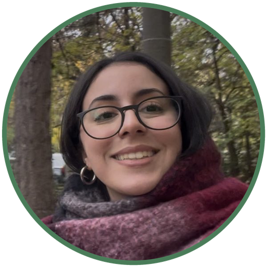

# 🌿 Oumaima Idhika

🌱 25 years old, from Rabat, now in Berlin 
🌿 Happy to start my Master's in Business Intelligence & Process Management at HWR Berlin 
🍃 Data engineer with 2+ years in data science & analytics

<!-- 🔗 Replace YOUR_LINKEDIN_URL below -->

---

## 🌍 Roots

I am from **Rabat**, Morocco's capital on the Atlantic coast. It is a calm, green city with an old medina, busy souks, gardens and ancient ruins.

It is where I went to school, did my preparatory classes and earned my engineering degree.

<table>
<tr>
<td width="33%">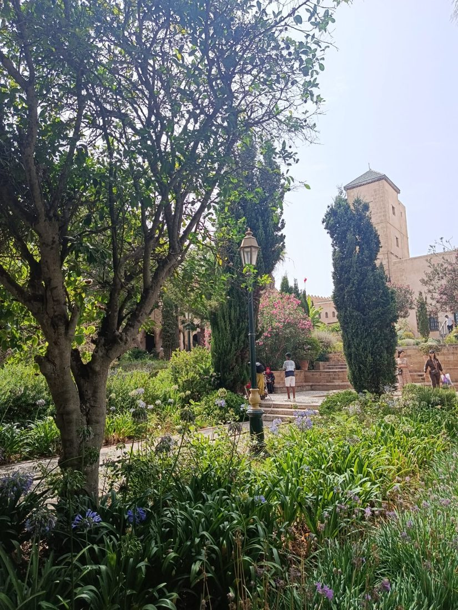</td>
<td width="33%">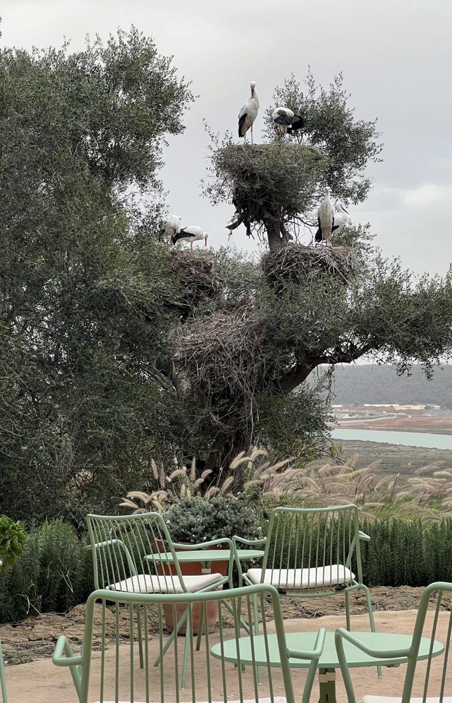</td>
<td width="33%">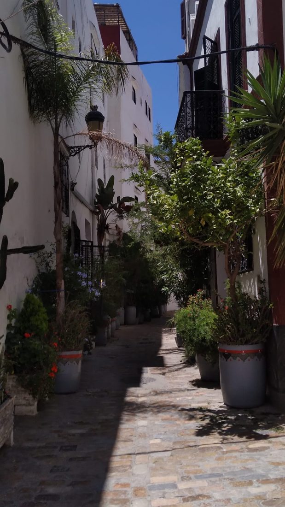</td>
</tr>
</table>
<table>
<tr>
<td width="50%">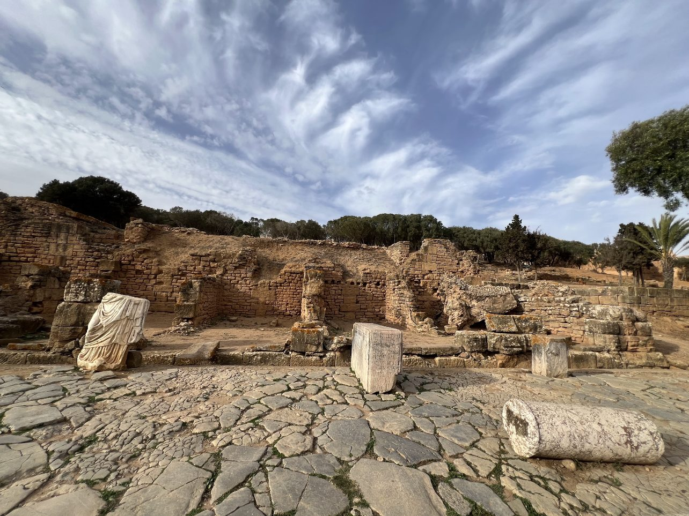</td>
<td width="50%">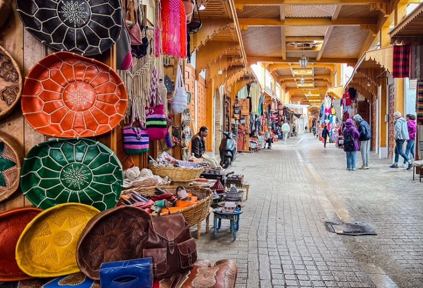</td>
</tr>
</table>

## 🍂 My path to HWR

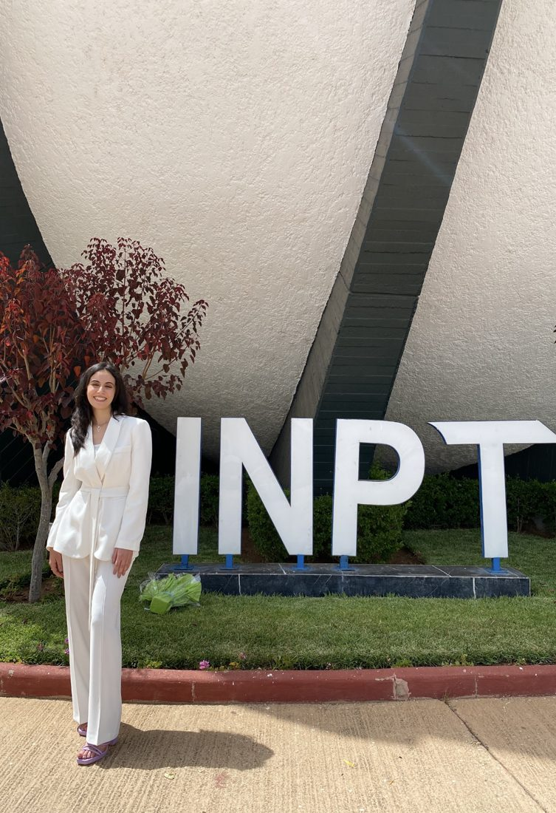

After graduating from INPT as a data engineer, I worked mostly in web development, with some data projects along the way. Today I want to grow towards a management role, which is why I joined the **Business Intelligence & Process Management** Master's at HWR Berlin.

 

## 🌱 Education

| Period | Programme | Where |
| --- | --- | --- |
| 2026 – today | Master's in Business Intelligence & Process Management | HWR Berlin |
| 2020 – 2023 | Engineering degree in Data Engineering | INPT, Rabat |
| 2018 – 2020 | Scientific preparatory classes, Mathematics & Physics (MP/MPSI) | CPGE Moulay Youssef, Rabat |
| 2017 – 2018 | Baccalaureate in Mathematical Sciences | Abi Dar Al Ghifari High School, Rabat |

## 🌿 Work experience

| Period | Role | Where |
| --- | --- | --- |
| Oct 2023 – Jun 2026 | **Freelance Web Developer & Data Scientist** Built new features for a web platform that helps hospitals plan their operating rooms, with some data work on forecasting and scheduling | SmartOp, France (remote) |
| Jan – Jul 2023 | **End-of-study internship in SAP BI** BI solution for budget planning with SAP Analytics tools | Inetum, Morocco |
| Jul – Sep 2022 | **Technical internship in AI** Real-time detection, tracking and trajectory analysis of vehicles and people at level crossings | MAScIR Foundation, Morocco |
| Jul – Oct 2021 | **Internship in web development** Design and build of a customised decision chatbot generator | HBS, Morocco (remote) |

## 🌻 What I love

**🏛️ Museums**

<table><tr>
<td width="50%">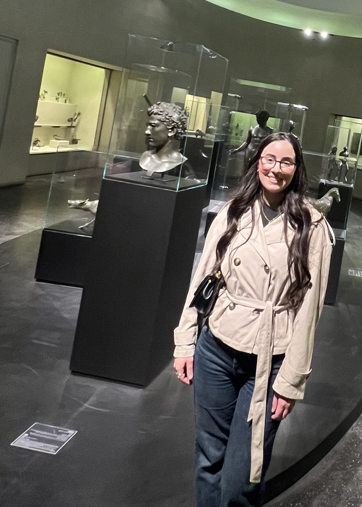</td>
<td width="50%">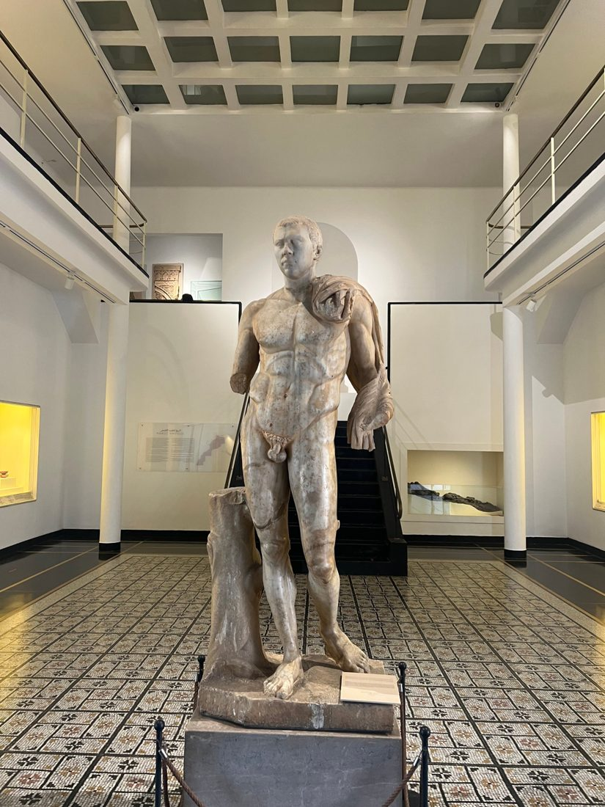</td>
</tr></table>

**🌿 Nature**

<table><tr>
<td width="50%">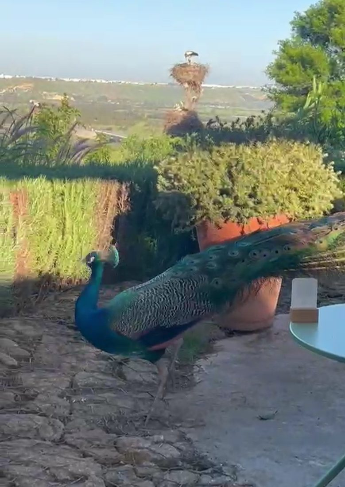</td>
<td width="50%">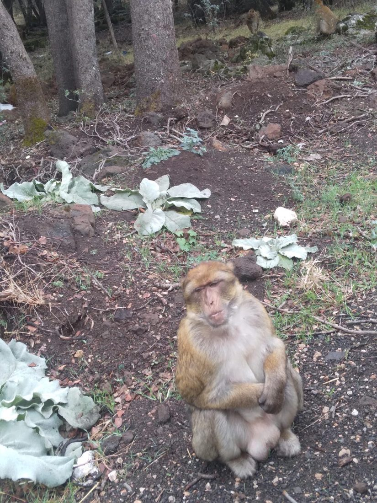</td>
</tr></table>

**🏺 Pottery**

<table><tr>
<td width="50%">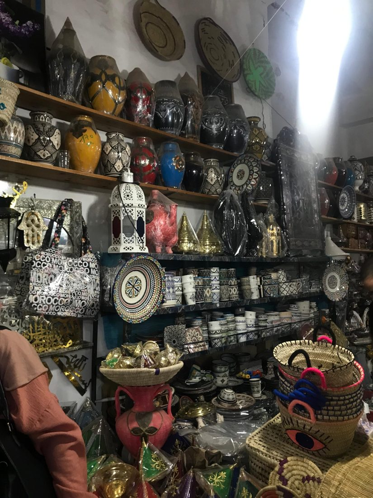</td>
<td width="50%">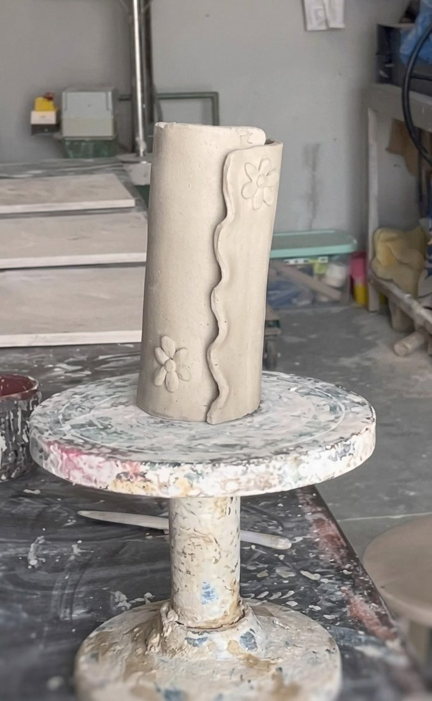</td>
</tr></table>

## 🌼 Languages

Arabic, French, English

## 🗺️ From Rabat to Berlin

The interactive map is on my page: **[oumaima-idhika.github.io/about-me](https://oumaima-idhika.github.io/about-me/)**
